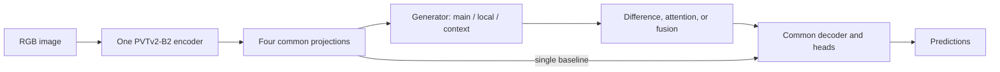

# 2026-11-01 · Pseudo-Scale Study — 방법별 비교 기준·실험 조건·평가 복구

[English](README.md) | **한국어** | [실행 안내](../../../README.ko.md) | [환경 설정](environment/README.ko.md)

환경 → 데이터 → 계획 생성 → 학습 → validation/비용 → 테스트 명령은 [저장소 README](../../../README.ko.md)에 있다. 이 문서는 **무엇을 비교하고 결과를 어떻게 해석할지** 설명한다. 생성 12종 × 활용 13종과 대조군 2개로 158개 구성, seed 3개 기준 474회다. Fusion을 지원하며 공통 decoder에 residual 표현을 강제하지 않는다.

## 2026-11-01 결과와 실험 조건 수정

[업로드된 priority8 보고서](results/priority8-report-20261101_172449/README.ko.md)는 seed 3407의 8개 실험을 **CAMO·CHAMELEON·NC4K에서만** 평가했다. COD10K-test를 추가하는 새 평가 plan은 기존 `best.pth`를 재사용하고 4개 테스트셋을 새 경로에서 다시 평가한다. `prepare` CLI는 이제 4개 테스트셋을 기본으로 요구하며, 리더보드는 실행 완료와 표준 벤치마크 전체 완료를 구분한다.

공식 ZoomNeXt는 학습 4,040장을 쓰지만 기존 비교는 학습 3,636장 + validation 404장이다. 새 `full_train`은 **4,040장 전체로 새로 학습하고 최종 epoch를 고정 선택**한다. 기존 결과·분할·체크포인트는 그대로 보존한다. 구조·손실·증강·정밀도 차이까지 같아진 것은 아니다. [공식 코드·논문 대조, 복구 및 새 학습 명령](docs/BENCHMARK-PROTOCOL.ko.md) · [Windows pull·SCP 전송](docs/BENCHMARK-PROTOCOL.ko.md#windows에서-수정-코드-전송).

## 비교별 질문 정하기

| 비교 | 고정 조건 | 확인할 질문 |
| --- | --- | --- |
| `single` 대 `identity + mean` | Seed, 공통 가중치, decoder | 수학적 bypass 동치 대조. 구현은 수치 허용오차 안에서 검증 |
| `projection + mean` 대 `native_conv + mean` | Projection 구조와 파라미터 수 | 같은 합성곱을 다른 해상도에서 수행하는 효과 |
| 모든 생성기 + `mean` | 활용기와 공통 조건 | 균등 fusion 아래 생성 방식의 효과 |
| 생성기 하나 + 모든 활용기 | 생성기와 공통 조건 | 같은 분기 특징을 차이·attention·fusion으로 활용하는 효과 |
| 전체 156조합 | 데이터, 공통 구조, 학습 조건 | 생성·활용의 상호작용. mean에서 좋은 생성기가 attention에서도 좋은지 |
| 선택한 변형 대 `single` | 공통 조건 | 추가 분기의 품질 이득이 비용을 감수할 만한지 |
| `legacy_full` 대 공통 구조 변형 | 데이터와 학습 조건 | 전체 구조 참고군이며 **단일 모듈 ablation은 아님** |

전체 실험은 `cross`를 한 번 생성한 뒤 위 부분집합으로 분석한다. 단계별 대안은 `generation --utilizer mean` 42회 → validation으로 생성기 선택 → `utilization --generator <선택값>` 45회다. phase 간 대조군이 중복되므로 결과 root와 집계를 분리한다. 전체 cross는 474회이며 세 계획을 모두 실행하는 것이 필수는 아니다.

## 공통 조건 고정

다음 표는 기존 개발용 `holdout` 프로토콜이다. `full_train`에서는 학습 4,040장·validation 없음·최종 epoch 고정 선택으로 바뀌며 나머지 공통 설정은 유지한다.

| 항목 | 공통 조건 |
| --- | --- |
| 모델 | 단일 PVTv2-B2 인코더, 공통 projection·decoder·예측 head |
| 입력 / 채널 | RGB 384×384 / 48 |
| 초기화 | 같은 로컬 backbone 가중치, 공통 부분 먼저 초기화 후 별도 seed로 변형 초기화 |
| 데이터 | 동일 manifest, split seed 1729, 학습 3,636 / validation 404 |
| 반복 | 모델 seeds 3407, 3408, 3409 |
| 최적화 | Adam, 150 epochs, batch 4, lr 1e-4; encoder lr ×0.1, weight decay 0 |
| 스케줄 / 고정 부분 | epoch 100에 lr ×0.1; 첫 patch embedding과 encoder BN 고정 |
| Loss 가중치 | segmentation 1 / deep .25 / region .5 / edge 1 / UAL 1 |
| 모델 선택 | 매 epoch validation의 이미지 수 가중 float MAE 최솟값 |
| 최종 보고 | 데이터셋별 test S, wF, MAE, E(adaptive/mean/max), seed 평균·표본 표준편차 및 추론 비용 |

공통 edge head는 `single`을 포함해 모든 비교군에서 fused 특징을 사용한다. Fusion 변형에 residual prior·compensation·residual 재주입을 강제하지 않는다. `legacy_full`만 [기존 FSA 전체 구조](../../FSA-ZoomNeXt/)를 유지한다. 공통 encoder/decoder 초기값과 데이터 순서는 변형 모듈의 크기에 영향을 받지 않게 분리했다. 대부분의 방식은 **파라미터·FLOPs가 일치하지 않으므로** 비용을 함께 보고 개선을 전부 scale reasoning 효과로 해석하지 않는다.

학습 가능한 생성기·활용기·공통 네트워크는 함께 최적화한다. “생성기 고정”은 구조와 설정을 고정한다는 뜻이며 최종 학습 특징값을 고정한다는 뜻은 아니다. 별도로 학습한 모델들에 동일한 feature bank를 동결해 제공하는 실험은 아니다.



## 생성 방식 목록

모든 생성기는 같은 B,C,H,W로 정렬한 `[main, large/local, small/context]`를 반환한다. Pooling 문맥과 dilation의 receptive field는 실제 크기 변경 이미지의 인코더 특징을 근사했다는 증거가 아니다.

| ID | 한국어 설명 | English description | Reference / 근거 |
| --- | --- | --- | --- |
| `identity` | 동일 특징 3개 | Duplicate-feature sanity control | 자체 통제 / study control |
| `projection` | 해상도를 유지한 독립 projection | Same-resolution capacity control | 자체 통제 |
| `legacy` | 기존 FSA의 큰 분기 projection·작은 분기 pool→복원→projection | Archived FSA generation order | 기존 소스 |
| `resample` | 1.5×·0.5× 보간 후 원래 크기 정렬 | Parameter-free resize-and-align | 자체 통제 |
| `native_conv` | 스케일 변경한 크기에서 합성곱 후 정렬 | Independent convolution at native scales | 자체 설계 |
| `shared_native` | 위 projection의 가중치를 두 스케일에서 공유 | Shared convolution across scales | 자체 설계 |
| `ffp_gain` | 스케일별 채널 power-law 보정 | Learned channel power-law correction | FFP 아이디어의 새 가설 |
| `sfp` | 전치합성곱·max pooling 피라미드 | Transposed-convolution / max-pooling pyramid | ViTDet SFP 변형 |
| `ppm` | 4·2 bin pooling 문맥 | Two pooling-context branches | PSPNet PPM 변형 |
| `aspp` | dilation 1·3의 병렬 합성곱 | Parallel atrous receptive fields | DeepLabv3 ASPP 변형 |
| `carafe` | 내용 기반 재조립 upsampling | Content-aware kernel reassembly | CARAFE 연산 변형 |
| `dysample` | 학습한 sampling offset으로 upsampling | Learned grouped sampling offsets | DySample LP/static-scope 변형 |

`sfp/carafe/dysample`은 2× upsampling, resize 계열은 기본 1.5×/0.5×다. 배율 효과를 분리하려면 별도 배율 일치 실험을 추가한다. 예를 들어 `run_study.py train`에 `--generator native_conv --generator-options '{"scale_factors":[2.0,0.5]}'`를 전달한다. 행렬 planner는 JSON options를 전달하지 않으므로 개별 학습 명령을 사용한다. 변경한 options는 새 결과 root에 기록한다. [생성 수식과 적용 차이](docs/GENERATION.md).

## 활용 방식 목록

| ID | 한국어 설명 | English description |
| --- | --- | --- |
| `mean` | 단순 평균 | Uniform mean |
| `concat` | 연결 후 bias 없는 1×1 projection | Concatenation and projection |
| `signed` | L−M, S−M | Signed differences relative to main |
| `absolute` | 위 차이의 절댓값 | Absolute differences |
| `relative` | 크기로 나눈 상대 차이 | Magnitude-normalized relative differences |
| `normalized` | 채널 L2 정규화 후 차이 | Differences of normalized channel vectors |
| `adjacent` | L−M, M−S | Oriented adjacent differences |
| `legacy_gated` | 기존 sigmoid residual gate와 출력 projection | Archived gated fusion branch |
| `bifpn` | 학습한 비음수 전역 가중치 | Fast normalized scalar fusion |
| `sk` | 채널별 스케일 softmax | Channel-wise scale selection |
| `asff` | 위치별 스케일 softmax | Spatial scale selection |
| `aff` | local/global 문맥을 이용한 단계적 혼합 | Nested local/global attentional fusion |
| `mhsiu` | 여러 head의 공간 선택과 value 변환 | Grouped multi-head spatial fusion |

차이 계열은 main에 bias 없는 difference projection을 더하므로 차이가 0이면 main을 반환한다. `signed`와 `adjacent`는 projection 부호를 바꾸면 **같은 함수군**이며 초기화·최적화 통제로 해석한다. `legacy_gated`의 독립 sigmoid 두 개는 main의 유효 계수를 음수로 만들 수 있다. [활용 수식과 적용 차이](docs/UTILIZATION.md).

## 결과 읽기와 보고

1. **같은 seeds와 manifest**에서 비교한다. Validation MAE와 비용으로 사용할 방법을 정하고 테스트를 보기 전에 비교 기준을 확정한다.
2. 가용 데이터셋별 S/wF/E는 높을수록, MAE는 낮을수록 좋다. Seed 평균·표본 표준편차와 같은 조건의 파라미터 수·latency·CUDA peak memory를 함께 보고한다.
3. 활용기를 고정한 생성 비교와 생성기를 고정한 활용 비교를 먼저 읽고 전체 조합을 해석한다. `projection` 용량 대조와 `single` 기준에서도 이득이 유지되는지 적는다.
4. `profile.json`의 분기 차이·cosine·attention 가중치 진단을 확인한다. 합성 입력이나 무작위 가중치만으로 학습된 유용성을 주장하지 않는다. 정성적 조사에는 학습 체크포인트와 `--image`의 실제 로컬 이미지를 사용한다.
5. 3,636/404 holdout 조건을 전체 4,040장 학습 논문과 구분한다. 실제 다중 스케일 teacher 특징을 target으로 사용하지 않으므로 분기 차이를 검증된 근사 오차라고 해석하지 않는다.

산출물, 재개 제한, strict checkpoint, 지표 규약과 개별 JSON option은 [상세 실행 안내](docs/RUNNING.md)에 있다. 환경 설치는 [영어](environment/README.md)·[한국어](environment/README.ko.md)로 제공한다.


## 확장 평가와 자동 리더보드

계획의 `run_all.sh`는 각 run의 학습·테스트 평가·profiling을 실행하고 단계마다 `plans/<phase>/leaderboard/leaderboard.html`을 갱신한다. 학습과 validation 순위만 필요하면 `train.sh`를 쓴다. 기본 holdout의 전체 선택 순위는 validation MAE, 테스트는 데이터셋별 순위, 비용은 별도 표로 나눈다. 프로토콜·완료 seed 집합별 그룹, 평균·표본 표준편차·미완료 상태를 함께 표시한다.

테스트 평가는 21개 수치, 이미지별 CSV, 원본 크기 확률 PNG, PR/Fβ/E 곡선 CSV+SVG+PNG를 저장한다. 비용 측정에는 MACs·행렬/합성곱 FLOPs·별도 비행렬 추정량·연산 커버리지를 추가했다. [지표 정의·근거·보고 규칙](docs/EVALUATION.ko.md)과 [대표 실행 안내](../../../README.ko.md)를 참고한다. 과거 결과는 보존하며 확장 평가에 별도 프로토콜을 부여한다.

## 테스트 이미지·마스크 크기 불일치 복구

아래는 2026-10-30 중단 당시의 복구 절차다. 이후 8개 학습이 완료되고 결과가 `shMin`으로 분리된 현재 작업에는 [4개 데이터셋 복구 안내](docs/BENCHMARK-PROTOCOL.ko.md#완료된-priority8-체크포인트-재평가)를 사용한다.

사용자가 제공한 우선 실험 로그에서 `single`은 150 epoch 학습을 완료했고, 이후 `chameleon_test/animal-62` 평가에서 멈췄다. 이미지가 1000×628, 마스크가 998×628(가로×세로)이어서 이전 로더의 크기 검사를 통과하지 못했다. 완료된 학습을 재사용할 수 있으므로 이 오류 때문에 `single`을 다시 학습할 필요는 없다.

`run_study.py evaluate`의 기본값은 계속 `--test-geometry strict`다. 테스트 평가에서 `--test-geometry resize-prediction-to-gt`를 명시하면 원본 이미지와 마스크의 크기가 달라도 평가한다. 이미지는 기존 모델 입력 크기로 변환하고, **예측만 원본 GT 크기로 bilinear 보간**한 뒤 지표를 계산한다. 원본 이미지·마스크·manifest를 수정하거나 표본을 제외·자르지 않는다. 학습 및 validation의 크기 일치 검사는 유지하므로 `best.pth` 선택 조건도 유지된다.

평가는 모델 추론 전에 선택된 모든 쌍을 검사하고 정책과 크기를 `geometry_audit.json` 및 평가 메타데이터에 기록한다. 이 크기 처리 방식은 GT 크기로 예측을 복원하는 [SINet 공식 테스트 코드](https://github.com/DengPingFan/SINet/blob/master/MyTest.py#L24-L45)와 원본 GT 해상도를 유지하는 [테스트 로더](https://github.com/DengPingFan/SINet/blob/master/Src/utils/Dataloader.py#L66-L89)를 근거로 한다(확인일 2026-10-30). 크기 처리 규약을 참고한 것이며 이 실험의 기존 정규화·보간 설정은 유지한다. 크기 검사는 이미지와 마스크의 의미적 정합을 입증하지 않는다. 실제 서버의 `animal-62` 원본 쌍은 로컬에서 확인하지 못했으므로 정합 여부는 미검증이다.

수정본으로 저장소를 업데이트한 뒤 아래 명령을 해당 서버에서 실행한다. 첫 블록은 **복구 계획만 생성**한다. 기존 manifest·backbone 가중치·run 폴더·체크포인트를 재사용하고, 완료된 학습을 건너뛸 수 있는지 확인하며, 평가는 새 하위 폴더로 보낸다. 이전 평가가 남긴 `test/`와 원래 plan·로그는 보존한다.

```bash
REPO="/home/master/mithila/INS_COD"
STUDY="$REPO/Experiments/shMin_2026-10-28/FSA-Pseudo-Scale-Study"
PY="$REPO/.venv/fsa-study-clean/bin/python"
RUN="$STUDY/results/priority8-seed3407-20261030_114816"
STAMP=$(TZ=Asia/Seoul date +%Y%m%d_%H%M%S)
RECOVERY="$RUN/plans/geometry-recovery-$STAMP"
"$PY" "$STUDY/recover_evaluation.py" \
  --plan "$RUN/plans/priority8/plan.json" \
  --output "$RECOVERY" \
  --evaluation-subdir "test-geometry-v1-$STAMP"
```

**같은 터미널**에서 다음 명령을 실행하면 검증된 완료 학습은 건너뛰고, 기존 baseline 평가·profiling → 나머지 예정 모델의 학습·평가·profiling을 진행한다. 중단된 optimizer 상태를 이어 학습하는 기능은 아니며, 미완료 학습 폴더가 있으면 오류를 유지하고 확인을 요구한다.

```bash
set -o pipefail
PYTHONUNBUFFERED=1 bash "$RECOVERY/run_all.sh" 2>&1 | tee "$RECOVERY/run.log"
```

각 실험의 21개 테스트 지표는 `$RUN` 아래 `runs/priority8/<variant>__seed3407/test-geometry-v1-<timestamp>/metrics.json`에 저장하고, 같은 폴더에 크기 검사 기록을 둔다. 새 리더보드는 `$RECOVERY/leaderboard/leaderboard.html`이며 터미널용 `leaderboard.md`도 있다. 기존 학습 소스 해시를 보존하므로 이전 baseline과 수정 코드로 학습한 모델은 서로 다른 비교 그룹에 표시될 수 있다. 하나의 순위를 만들기 위해 출처 정보를 지우지 말고, 기록된 코드 차이를 확인해 그룹을 해석한다. Epoch 로그에는 validation MAE가 나오며 전체 21개 지표는 각 테스트 평가가 끝난 뒤 생성된다.

## 참고 논문

확인일 **2026-10-28**. 한국어 제목은 이해를 위한 번역이다. 전체 논문의 재현이 아닌 아이디어 적용 실험이다. 공식 출처·발표처·수식·수정 범위는 [GENERATION](docs/GENERATION.md)과 [UTILIZATION](docs/UTILIZATION.md)에 보존한다.

| English title / 한국어 제목 | Official venue and publication status / 발표·공개처 | Applied idea / 적용 범위 |
| --- | --- | --- |
| [Fast Feature Pyramids for Object Detection](https://doi.org/10.1109/TPAMI.2014.2300479)<br>객체 검출을 위한 빠른 특징 피라미드 | IEEE Transactions on Pattern Analysis and Machine Intelligence (TPAMI), 2014, journal / 저널 | FFP의 scale power law. 원래 저수준 특징의 통계적 보정을 학습 가능한 CNN 채널 지수로 바꾼 새 가설 / new deep-feature adaptation |
| [Exploring Plain Vision Transformer Backbones for Object Detection](https://link.springer.com/chapter/10.1007/978-3-031-20077-9_17)<br>객체 검출을 위한 비계층적 비전 트랜스포머 백본 탐구 | European Conference on Computer Vision (ECCV), 2022, conference / 학회 | SFP의 up/down feature pyramid를 각 PVT stage에 적용 / per-stage SFP adaptation |
| [Pyramid Scene Parsing Network](https://openaccess.thecvf.com/content_cvpr_2017/html/Zhao_Pyramid_Scene_Parsing_CVPR_2017_paper.html)<br>피라미드 장면 파싱 네트워크 | IEEE Conference on Computer Vision and Pattern Recognition (CVPR), 2017, conference / 학회 | Pooling 문맥. 실제 이미지 스케일 근사와 구분 / pooled context, not verified image-scale approximation |
| [Rethinking Atrous Convolution for Semantic Image Segmentation](https://arxiv.org/abs/1706.05587)<br>의미론적 영상 분할을 위한 팽창 합성곱의 재고찰 | arXiv:1706.05587, 2017, preprint / 프리프린트; 정식 발표처 미확인 | 두 dilation branch로 축소 / reduced ASPP branches |
| [CARAFE: Content-Aware ReAssembly of FEatures](https://openaccess.thecvf.com/content_ICCV_2019/html/Wang_CARAFE_Content-Aware_ReAssembly_of_FEatures_ICCV_2019_paper.html)<br>CARAFE: 내용 인지적 특징 재조립 | IEEE/CVF International Conference on Computer Vision (ICCV), 2019, conference / 학회 | 순수 PyTorch kernel prediction/reassembly. 공식 CUDA의 속도 재현 아님 / no fused-CUDA efficiency claim |
| [Learning to Upsample by Learning to Sample](https://openaccess.thecvf.com/content/ICCV2023/html/Liu_Learning_to_Upsample_by_Learning_to_Sample_ICCV_2023_paper.html)<br>샘플링을 학습하여 업샘플링하기 | IEEE/CVF International Conference on Computer Vision (ICCV), 2023, conference / 학회 | Offset sampling을 생성에 사용 / offsets for pseudo-scale generation |
| [Selective Kernel Networks](https://openaccess.thecvf.com/content_CVPR_2019/html/Li_Selective_Kernel_Networks_CVPR_2019_paper.html)<br>선택적 커널 네트워크 | IEEE/CVF Conference on Computer Vision and Pattern Recognition (CVPR), 2019, conference / 학회 | Fuse/select만 차용 / channel selection on external branches |
| [Learning Spatial Fusion for Single-Shot Object Detection](https://arxiv.org/abs/1911.09516)<br>단일 단계 객체 탐지를 위한 공간 융합 학습 | arXiv:1911.09516, 2019, preprint / 프리프린트; 정식 발표처 미확인 | ASFF 공간 가중치 / spatial scale weights |
| [EfficientDet: Scalable and Efficient Object Detection](https://openaccess.thecvf.com/content_CVPR_2020/html/Tan_EfficientDet_Scalable_and_Efficient_Object_Detection_CVPR_2020_paper.html)<br>EfficientDet: 확장 가능하고 효율적인 객체 탐지 | IEEE/CVF Conference on Computer Vision and Pattern Recognition (CVPR), 2020, conference / 학회 | BiFPN의 빠른 정규화 혼합만 차용 / fusion operator, not full BiFPN |
| [Attentional Feature Fusion](https://openaccess.thecvf.com/content/WACV2021/html/Dai_Attentional_Feature_Fusion_WACV_2021_paper.html)<br>어텐션 기반 특징 융합 | IEEE/CVF Winter Conference on Applications of Computer Vision (WACV), 2021, conference / 학회 | 논문 Eq.4 convex blend. 공식 코드의 ×2 gain 생략 / paper blending convention |
| [ZoomNeXt: A Unified Collaborative Pyramid Network for Camouflaged Object Detection](https://doi.org/10.1109/TPAMI.2024.3417329)<br>ZoomNeXt: 위장 객체 탐지를 위한 통합 협력 피라미드 네트워크 | IEEE Transactions on Pattern Analysis and Machine Intelligence (TPAMI), 2024, journal / 저널 | MHSIU-inspired 활용. 원래 실제 세 입력 인코딩을 재현하지 않음 / pseudo-feature adaptation |
| [Boundary IoU: Improving Object-Centric Image Segmentation Evaluation](https://openaccess.thecvf.com/content/CVPR2021/html/Cheng_Boundary_IoU_Improving_Object-Centric_Image_Segmentation_Evaluation_CVPR_2021_paper.html)<br>Boundary IoU: 객체 중심 이미지 분할 평가의 개선 | IEEE/CVF Conference on Computer Vision and Pattern Recognition (CVPR), 2021, conference / 학회 | 추가 경계 평가지표. 저자 erosion 규약 적용; 확인일 2026-10-29 / additional boundary evaluation |

## 현재 검증 상태

[기존 검증 기록](results/verification-2026-10-28/README.md)은 281 tests + 67 subtests 통과이며 전체 156개 모듈 조합, 공통 초기화, 원본 연산 일치, 데이터·체크포인트, CPU/GPU 추론을 포함한다. Optimizer step, 실제 데이터 학습, 데이터 다운로드는 실행하지 않았다. 실제 사전학습 파일 로딩·수렴·정확도 순위는 미검증이다. [연구 기록](../../../Progress/2026-10-28/Pseudo-Scale-Study/README.md)에서 코드 관측과 가설을 구분한다.

2026-10-29 평가·리더보드 검증: **522 tests + 67 subtests**, 전체 158개 초기화 모델 연산 커버리지, 브라우저 8개 검사 통과. 학습·다운로드는 실행하지 않았다. [2026-10-29 검증 기록](results/verification-2026-10-29-metrics/README.md).

2026-10-30 크기 불일치 복구 검증: **557 tests + 67 subtests 통과**. 이미지 1000×628 / GT 998×628을 합성 데이터로 재현하여 21개 유한 지표, 입력·checkpoint 바이트 보존, train/val 엄격 검사와 기존 모델을 재사용하는 복구 순서를 확인했다. 학습·다운로드는 실행하지 않았고 실제 서버 원본 쌍은 미검증이다. [검증 산출물](results/verification-2026-10-30-geometry/README.md) · [변경 기록](../../../Progress/2026-10-30/Geometry-Recovery/README.md).

2026-11-01의 새 데이터 프로토콜과 벤치마크 완성 기능은 [변경 기록](../../../Progress/2026-11-01/Benchmark-Completion/README.md)에 정리했다. 새 실제 데이터 학습·4개 벤치마크 평가 결과는 아직 실행 전이며 과거 검증 수치와 구분한다.
