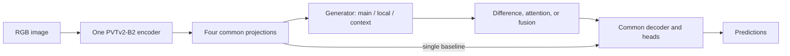

# 2026-10-29 · Pseudo-Scale Study — Methods and comparison protocol

**English** | [한국어](README.ko.md) | [Execution guide](../../../README.md) | [Environment setup](environment/README.md)

Use the [repository README](../../../README.md) for environment → data → plan → training → validation/cost → test commands. This document explains **what to compare and how to interpret it**. There are 12 generators × 13 utilizers plus two controls: 158 configurations, or 474 runs with three seeds. Fusion is supported throughout; the decoder does not require a residual representation.

## Decide which question each comparison answers

| Comparison | Hold fixed | What it tests |
| --- | --- | --- |
| `single` vs `identity + mean` | Seed, common weights, decoder | Mathematical bypass sanity check; implementation is tested within numerical tolerance |
| `projection + mean` vs `native_conv + mean` | Projection architecture and parameter count | Whether applying the same convolution at a changed resolution helps |
| All generators with `mean` | Utilizer and common protocol | Generation effects under uniform fusion |
| All utilizers with one generator | Generator and common protocol | How difference/attention/fusion uses the same branch bank |
| All 156 pairings | Data, common architecture and training protocol | Generator–utilizer interaction; a generation ranking under mean need not persist under attention |
| Selected variants vs `single` | Common protocol | Whether extra branches improve quality enough to justify their cost |
| `legacy_full` vs controlled variants | Data and training protocol | Whole-architecture reference; **not** a one-module ablation |

For the complete study, generate `cross` once and analyze these subsets. A staged alternative uses `generation --utilizer mean` (42 runs), chooses a generator from validation, then `utilization --generator <choice>` (45 runs). These phases include repeated controls, so keep their result roots and summaries separate. A cross plan has 474 runs; running all three plans is optional, not required.

## Keep the comparison conditions fixed

| Setting | Common protocol |
| --- | --- |
| Model | One PVTv2-B2 encoder; shared projections, decoder and prediction heads |
| Input / channels | RGB 384×384 / 48 |
| Initialization | Same local backbone weights; common modules initialized before separately seeded variants |
| Data | One manifest, split seed 1729; 3,636 train / 404 validation |
| Repeats | Model seeds 3407, 3408, 3409 |
| Optimization | Adam, 150 epochs, batch 4, lr 1e-4; encoder lr ×0.1, weight decay 0 |
| Schedule / frozen parts | lr ×0.1 at epoch 100; first patch embedding and encoder BN fixed |
| Loss weights | segmentation 1 / deep .25 / region .5 / edge 1 / UAL 1 |
| Selection | Minimum sample-weighted validation float MAE, evaluated every epoch |
| Final reporting | 21 dataset-specific test scores, curves, per-image artifacts; seed mean/sample SD, inference cost and validation-led leaderboards |

The common edge head consumes fused features for all controlled variants, including `single`. No residual prior, compensation, or residual reinjection is forced onto fusion variants. `legacy_full` alone retains the [archived FSA architecture](../../FSA-ZoomNeXt/). Common encoder/decoder initialization and data order are isolated from variant module size. Most methods are **not parameter- or FLOP-matched**, so report cost rather than attributing all gains to scale reasoning.

Trainable generators, utilizers and common network components are optimized jointly. A “fixed generator” comparison fixes its architecture and settings, not its final learned feature values. It does not freeze an identical feature bank across separately trained models.

## Generator catalog

Each generator returns `[main, large/local, small/context]` aligned to the same B,C,H,W shape. Pooled context and dilated receptive fields are not evidence that a real resized image's encoder features have been approximated.

| ID | Generation method | Reference |
| --- | --- | --- |
| `identity` | Duplicate-feature sanity control | Study control |
| `projection` | Same-resolution capacity control | Study capacity control |
| `legacy` | Archived FSA generation order | Archived FSA source |
| `resample` | Parameter-free resize-and-align | Study control |
| `native_conv` | Independent convolution at native scales | Study design |
| `shared_native` | Shared convolution across scales | Study design |
| `ffp_gain` | Learned channel power-law correction | FFP-inspired new hypothesis |
| `sfp` | Transposed-convolution / max-pooling pyramid | ViTDet SFP adaptation |
| `ppm` | Two pooling-context branches | PSPNet PPM adaptation |
| `aspp` | Parallel atrous receptive fields | DeepLabv3 ASPP adaptation |
| `carafe` | Content-aware kernel reassembly | CARAFE operator adaptation |
| `dysample` | Learned grouped sampling offsets | DySample LP/static-scope adaptation |

`sfp`, `carafe` and `dysample` use 2× upsampling; the resampling family defaults to 1.5×/0.5×. To isolate scale-factor effects, add a separate matched-scale experiment, for example `--generator native_conv --generator-options '{"scale_factors":[2.0,0.5]}'` through `run_study.py train`. JSON options are not forwarded by the matrix planner. Use a new result root for changed options. [Generation formulas and adaptations](docs/GENERATION.md).

## Utilizer catalog

| ID | Utilization method |
| --- | --- |
| `mean` | Uniform mean |
| `concat` | Concatenation and projection |
| `signed` | Signed differences relative to main |
| `absolute` | Absolute differences |
| `relative` | Magnitude-normalized relative differences |
| `normalized` | Differences of normalized channel vectors |
| `adjacent` | Oriented adjacent differences |
| `legacy_gated` | Archived gated fusion branch |
| `bifpn` | Fast normalized scalar fusion |
| `sk` | Channel-wise scale selection |
| `asff` | Spatial scale selection |
| `aff` | Nested local/global attentional fusion |
| `mhsiu` | Grouped multi-head spatial fusion |

The difference variants use main plus a bias-free projection of differences; zero difference returns main. `signed` and `adjacent` express the **same function family** after a projection-sign reparameterization, so compare them as initialization/optimization controls. `legacy_gated` has two independent sigmoid gates; its effective main coefficient can be negative. [Utilization formulas and adaptations](docs/UTILIZATION.md).

## Read and report the results

1. Compare the **same seeds and manifest**. Choose the intended method using validation MAE and cost, then fix the comparison before interpreting test results.
2. Report S/wF/E upward and MAE downward for each available dataset. Include mean/sample SD across seeds, parameters, latency and peak CUDA memory under the same profiling protocol.
3. Compare generation at fixed utilization and utilization at fixed generation before drawing a conclusion from the full grid. Record whether a gain survives the `projection` capacity control and the `single` baseline.
4. Inspect `profile.json` branch difference, cosine and attention-weight diagnostics when available. Synthetic/random-weight diagnostics alone cannot establish learned utility; use trained checkpoints and representative local images with `--image` for qualitative investigation.
5. Keep the 3,636/404 holdout protocol distinct from published models trained on all 4,040 images. No actual multiscale teacher-feature target is used, so branch differences are not verified approximation error.

Outputs, resumption limitations, strict checkpoint loading, metric conventions and per-variant JSON options are documented in [advanced execution details](docs/RUNNING.md). Environment installation is in the [English](environment/README.md) and [Korean](environment/README.ko.md) environment guides.

## Expanded evaluation and automatic leaderboards

The planned `run_all.sh` executes training, test evaluation and profiling per run and refreshes `plans/<phase>/leaderboard/leaderboard.html` after every stage. Use `train.sh` for training and validation ranking only. Validation MAE determines the overall selection ranking; dataset-specific test rankings and cost tables are separate. All tables retain protocol and completed-seed groups, mean/sample SD and missing-run status.

Test evaluation now exports 21 scalar scores, per-image CSV, original-size probability PNGs and PR/Fβ/E curves as CSV+SVG+PNG. Profiling adds MACs, contraction FLOPs, a separate noncontraction estimate and operator coverage. See [metric definitions, references and reporting rules](docs/EVALUATION.md) and the [main execution guide](../../../README.md). Historical results are preserved; expanded evaluations have their own metric protocol.

## Referenced papers

Checked on **2026-10-28**. Korean title translations are provided in the [Korean version](README.ko.md). These are adaptations, not full-paper reproductions. The original source, venue, formulas and precise changes are retained in [GENERATION](docs/GENERATION.md) and [UTILIZATION](docs/UTILIZATION.md).

| Paper | Official venue and publication status | Applied idea |
| --- | --- | --- |
| [Fast Feature Pyramids for Object Detection](https://doi.org/10.1109/TPAMI.2014.2300479) | IEEE Transactions on Pattern Analysis and Machine Intelligence (TPAMI), 2014; journal | FFP scale power law; adapting calibrated low-level features to learnable deep-feature channel exponents is a new hypothesis. |
| [Exploring Plain Vision Transformer Backbones for Object Detection](https://link.springer.com/chapter/10.1007/978-3-031-20077-9_17) | European Conference on Computer Vision (ECCV), 2022; conference | Apply the Simple Feature Pyramid idea per PVT stage, with aligned branches; not a ViT detector reproduction. |
| [Pyramid Scene Parsing Network](https://openaccess.thecvf.com/content_cvpr_2017/html/Zhao_Pyramid_Scene_Parsing_CVPR_2017_paper.html) | IEEE Conference on Computer Vision and Pattern Recognition (CVPR), 2017; conference | Pooled context branches; these do not establish approximation of real image-scale features. |
| [Rethinking Atrous Convolution for Semantic Image Segmentation](https://arxiv.org/abs/1706.05587) | arXiv:1706.05587, 2017; preprint. Formal venue unverified. | Two atrous branches with reduced dilation settings; no complete DeepLabv3 reproduction. |
| [CARAFE: Content-Aware ReAssembly of FEatures](https://openaccess.thecvf.com/content_ICCV_2019/html/Wang_CARAFE_Content-Aware_ReAssembly_of_FEatures_ICCV_2019_paper.html) | IEEE/CVF International Conference on Computer Vision (ICCV), 2019; conference | Content-aware reassembly in pure PyTorch; no claim of the official fused CUDA implementation's efficiency. |
| [Learning to Upsample by Learning to Sample](https://openaccess.thecvf.com/content/ICCV2023/html/Liu_Learning_to_Upsample_by_Learning_to_Sample_ICCV_2023_paper.html) | IEEE/CVF International Conference on Computer Vision (ICCV), 2023; conference | LP/static-scope offset sampling for pseudo-scale generation, followed by alignment. |
| [Selective Kernel Networks](https://openaccess.thecvf.com/content_CVPR_2019/html/Li_Selective_Kernel_Networks_CVPR_2019_paper.html) | IEEE/CVF Conference on Computer Vision and Pattern Recognition (CVPR), 2019; conference | Fuse/select channel attention on externally generated branches; not the original SK split kernels. |
| [Learning Spatial Fusion for Single-Shot Object Detection](https://arxiv.org/abs/1911.09516) | arXiv:1911.09516, 2019; preprint. Formal venue unverified. | ASFF-inspired spatial scale weights for already aligned pseudo features. |
| [EfficientDet: Scalable and Efficient Object Detection](https://openaccess.thecvf.com/content_CVPR_2020/html/Tan_EfficientDet_Scalable_and_Efficient_Object_Detection_CVPR_2020_paper.html) | IEEE/CVF Conference on Computer Vision and Pattern Recognition (CVPR), 2020; conference | Fast normalized fusion operator only; not the complete bidirectional BiFPN network. |
| [Attentional Feature Fusion](https://openaccess.thecvf.com/content/WACV2021/html/Dai_Attentional_Feature_Fusion_WACV_2021_paper.html) | IEEE/CVF Winter Conference on Applications of Computer Vision (WACV), 2021; conference | Paper Eq. 4 convex blend with nested three-branch fusion; omit the official code's x2 gain. |
| [ZoomNeXt: A Unified Collaborative Pyramid Network for Camouflaged Object Detection](https://doi.org/10.1109/TPAMI.2024.3417329) | IEEE Transactions on Pattern Analysis and Machine Intelligence (TPAMI), 2024; journal | MHSIU-inspired grouped attention/value transforms; not the original three-image encoder pipeline. |
| [Boundary IoU: Improving Object-Centric Image Segmentation Evaluation](https://openaccess.thecvf.com/content/CVPR2021/html/Cheng_Boundary_IoU_Improving_Object-Centric_Image_Segmentation_Evaluation_CVPR_2021_paper.html) | IEEE/CVF Conference on Computer Vision and Pattern Recognition (CVPR), 2021; conference | Additional boundary metric using the authors' erosion convention; checked 2026-10-29. |

## Current verification status

[Recorded verification](results/verification-2026-10-28/README.md): 281 tests and 67 subtests passed, including all 156 module pairings, common initialization, original-operator agreement, data/checkpoint checks and CPU/GPU inference. No optimizer steps, real-data training or dataset downloads were run. Actual pretrained-file loading, convergence and accuracy rankings remain unverified. The [research record](../../../Progress/2026-10-28/Pseudo-Scale-Study/README.md) separates code observations from hypotheses.

Latest metric/leaderboard verification: **522 tests + 67 subtests**, operation coverage for all 158 initialized models, and eight browser checks passed. No training or downloads were run. [2026-10-29 verification](results/verification-2026-10-29-metrics/README.md).
