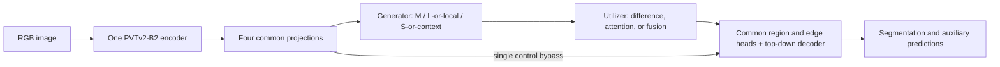

# 2026-10-28 · Pseudo-Scale Study — 생성과 활용 방식의 독립 비교

**단일 PVTv2-B2 인코더에서 만든 pseudo-scale 특징을 어떻게 생성하고 활용해야 하는지 비교하는 실험 코드다.** 활용 방식에는 residual뿐 아니라 평균·연결·가중 fusion·채널/공간 attention을 포함한다. 생성기 12개 × 활용기 13개 = **156개 조합**, pseudo를 완전히 생략한 `single` 및 기존 전체 구조 `legacy_full`을 더하면 **158개 구성**이다. 기본 3개 seed에서는 474회 학습 명령을 생성한다. 명령 생성은 학습을 시작하지 않는다.

**English.** This study separates *how pseudo-scale features are generated* from *how they are used*. Twelve generators and thirteen utilizers share one PVTv2-B2 encoder, feature projections, decoder, heads, losses, split, and initialization protocol. Fusion is a first-class alternative to subtraction. The 156 pairings plus two controls yield 158 configurations, or 474 runs with three seeds. These are runnable experiments, **not measured COD improvements or full paper reproductions**.

원본 [FSA-ZoomNeXt](../../FSA-ZoomNeXt/)는 수정하지 않았다. 기존 BRG main 실험은 [COD](https://github.com/sh-min/COD)에 유지하며 CoCoNet은 이번 저장소에 포함하지 않는다.

## 연구 질문과 비교 조건 / Research questions and controls

1. **생성의 이득**: 실제 해상도 변환, 문맥 범위 변화, 학습된 upsampling이 같은 해상도의 추가 projection보다 도움이 되는가? / Does scale/context construction outperform additional same-resolution capacity?
2. **활용의 이득**: 차이값보다 직접 fusion이나 입력 의존 attention이 유리한가? / Is subtraction preferable to direct fusion or adaptive selection?
3. **비용 대비 이득**: 성능이 좋아져도 latency·메모리·파라미터 증가를 감수할 만한가? / Is any accuracy gain worth the measured inference cost?

`single`은 generator/utilizer 자체를 생성·호출하지 않는다. `identity + mean`은 같은 특징 세 개를 평균하므로 이 기준 모델과 수치적으로 같아야 하는 sanity control이다. `projection`과 `native_conv`는 같은 projection 구조와 파라미터 수를 사용하되 계산 위치만 다르다. 다른 방법들까지 파라미터·FLOPs가 일치한다고 주장하지 않는다.



공통 부분을 먼저 동일 seed로 초기화한 뒤, generator/utilizer는 별도 seed로 초기화한다. 모델 크기에 따라 인코더·디코더 초기값이나 데이터 순서가 바뀌지 않는다. baseline을 포함한 공통 디코더의 edge head는 **fused 특징**에서 edge를 예측한다. 특정 방법에 residual head·compensation·residual 재주입을 강제하지 않는다. `legacy_full`만 원래 FSA의 residual prior·compensation·refinement를 유지한다. 이는 전체 구조 참고군이며 새 공통 디코더의 한 요인만 바꾼 ablation이 아니다.

**English.** Common parameters are initialized before variant modules, under isolated CPU RNG scopes. Independent model and data RNGs prevent module size from changing shared weights or sample order. The common edge head consumes fused features; it does not require a residual representation. `legacy_full` retains the archived architecture and is an architectural reference, not an isolated one-factor ablation.

## 생성 방식 / Generation methods

모든 생성기는 `[main, large/local, small/context]` 순서의 같은 크기 특징 세 개를 반환한다. pooling·dilation은 문맥 범위 변형이며, 실제 확대·축소 이미지의 인코더 특징을 근사했다는 뜻은 아니다.

| ID | 한국어 설명 | English description | 근거 |
| --- | --- | --- | --- |
| `identity` | 동일 특징 3개 | Duplicate-feature sanity control | 자체 통제 / study control |
| `projection` | 해상도를 유지한 독립 projection | Same-resolution capacity control | 자체 통제 |
| `legacy` | 기존 FSA의 큰 분기 projection·작은 분기 pool→복원→projection | Archived FSA generation order | 기존 소스 |
| `resample` | 1.5×·0.5× 보간 후 원래 크기 정렬 | Parameter-free resize-and-align | 자체 통제 |
| `native_conv` | 스케일 변경한 크기에서 합성곱 후 정렬 | Independent convolution at native scales | 자체 설계 |
| `shared_native` | 위 projection의 가중치를 두 스케일에서 공유 | Shared convolution across scales | 자체 설계 |
| `ffp_gain` | 스케일별 채널 power-law 보정 | Learned channel power-law correction | FFP 아이디어의 새 가설 |
| `sfp` | 전치합성곱·max pooling 피라미드 | Transposed-convolution / max-pooling pyramid | ViTDet SFP 변형 |
| `ppm` | 4·2 bin pooling 문맥 | Two pooling-context branches | PSPNet PPM 변형 |
| `aspp` | dilation 1·3의 병렬 합성곱 | Parallel atrous receptive fields | DeepLabv3 ASPP 변형 |
| `carafe` | 내용 기반 재조립 upsampling | Content-aware kernel reassembly | CARAFE 연산 변형 |
| `dysample` | 학습한 sampling offset으로 upsampling | Learned grouped sampling offsets | DySample LP/static-scope 변형 |

`sfp/carafe/dysample`의 upsampling은 기본 2×이며 나머지 resize 계열의 기본 large 1.5×와 다르다. 원논문 연산에 맞춘 차이를 metadata에 남긴다. 생성 family 효과와 배율 효과를 구분하려면 `native_conv` 등에 `--generator-options '{"scale_factors":[2.0,0.5]}'`를 주어 추가 통제한다. [상세 구현·수식·변경점](docs/GENERATION.md).

## 활용 방식 / Utilization methods

| ID | 한국어 설명 | English description |
| --- | --- | --- |
| `mean` | 단순 평균 | Uniform mean |
| `concat` | 연결 후 bias 없는 1×1 projection | Concatenation and projection |
| `signed` | L−M, S−M | Signed differences relative to main |
| `absolute` | 위 차이의 절댓값 | Absolute differences |
| `relative` | 크기로 나눈 상대 차이 | Magnitude-normalized relative differences |
| `normalized` | 채널 L2 정규화 후 차이 | Differences of normalized channel vectors |
| `adjacent` | L−M, M−S | Oriented adjacent differences |
| `legacy_gated` | 기존 sigmoid residual gate와 출력 projection | Archived gated fusion branch |
| `bifpn` | 학습한 비음수 전역 가중치 | Fast normalized scalar fusion |
| `sk` | 채널별 스케일 softmax | Channel-wise scale selection |
| `asff` | 위치별 스케일 softmax | Spatial scale selection |
| `aff` | local/global 문맥을 이용한 단계적 혼합 | Nested local/global attentional fusion |
| `mhsiu` | 여러 head의 공간 선택과 value 변환 | Grouped multi-head spatial fusion |

차이 계열은 `M + bias-free projection(differences)`로 통일하여 차이가 0이면 정확히 M을 반환한다. `signed`와 `adjacent`는 projection의 부호 재매개변수화로 **같은 함수군**이다. 둘의 차이는 표현력 증거가 아니라 초기화·최적화 효과로 해석해야 한다. `legacy_gated`의 독립 sigmoid 두 개는 합이 1로 제한되지 않아 main의 유효 계수가 음수가 될 수 있다. [상세 수식·정규화·원논문 대비 변경점](docs/UTILIZATION.md).

## 참고 논문 / Referenced papers

확인일 / Checked: **2026-10-28**. 한국어 제목은 이해를 위한 번역이다. Exa 검색 두 갈래의 검색 반환 수 합계는 59이며, 이는 중복 제거된 논문 수가 아니다. 아래 11개 방법 논문에서 아이디어를 가져왔다. 공식 논문과 저자 구현을 확인했으며, 핵심 연산을 이 연구의 세 분기·공통 디코더에 맞춰 적용했다.

| English title / 한국어 제목 | 공식 발표·공개처 / Venue and status | 적용 / Application |
| --- | --- | --- |
| [Fast Feature Pyramids for Object Detection](https://doi.org/10.1109/TPAMI.2014.2300479)<br>객체 검출을 위한 빠른 특징 피라미드 | IEEE Transactions on Pattern Analysis and Machine Intelligence (TPAMI), 2014, journal / 저널 | FFP의 scale power law. 원래 저수준 특징의 통계적 보정을 학습 가능한 CNN 채널 지수로 바꾼 새 가설 / new deep-feature adaptation |
| [Exploring Plain Vision Transformer Backbones for Object Detection](https://link.springer.com/chapter/10.1007/978-3-031-20077-9_17)<br>객체 검출을 위한 비계층적 비전 트랜스포머 백본 탐구 | European Conference on Computer Vision (ECCV), 2022, conference / 학회 | SFP의 up/down feature pyramid를 각 PVT stage에 적용 / per-stage SFP adaptation |
| [Pyramid Scene Parsing Network](https://openaccess.thecvf.com/content_cvpr_2017/html/Zhao_Pyramid_Scene_Parsing_CVPR_2017_paper.html)<br>피라미드 장면 파싱 네트워크 | IEEE Conference on Computer Vision and Pattern Recognition (CVPR), 2017, conference / 학회 | Pooling 문맥. 실제 이미지 스케일 근사와 구분 / pooled context, not verified image-scale approximation |
| [Rethinking Atrous Convolution for Semantic Image Segmentation](https://arxiv.org/abs/1706.05587)<br>의미론적 영상 분할을 위한 팽창 합성곱의 재고찰 | arXiv:1706.05587, 2017, preprint / 프리프린트; 정식 발표처 미확인 | 두 dilation branch로 축소 / reduced ASPP branches |
| [CARAFE: Content-Aware ReAssembly of FEatures](https://openaccess.thecvf.com/content_ICCV_2019/html/Wang_CARAFE_Content-Aware_ReAssembly_of_FEatures_ICCV_2019_paper.html)<br>CARAFE: 내용 인지적 특징 재조립 | IEEE/CVF International Conference on Computer Vision (ICCV), 2019, conference / 학회 | 순수 PyTorch kernel prediction/reassembly. 공식 CUDA의 속도 재현 아님 / no fused-CUDA efficiency claim |
| [Learning to Upsample by Learning to Sample](https://openaccess.thecvf.com/content/ICCV2023/html/Liu_Learning_to_Upsample_by_Learning_to_Sample_ICCV_2023_paper.html)<br>샘플링을 학습하여 업샘플링하기 | IEEE/CVF International Conference on Computer Vision (ICCV), 2023, conference / 학회 | Offset sampling을 생성에 사용 / offsets for pseudo-scale generation |
| [Selective Kernel Networks](https://openaccess.thecvf.com/content_CVPR_2019/html/Li_Selective_Kernel_Networks_CVPR_2019_paper.html)<br>선택적 커널 네트워크 | IEEE/CVF Conference on Computer Vision and Pattern Recognition (CVPR), 2019, conference / 학회 | Fuse/select만 차용 / channel selection on external branches |
| [Learning Spatial Fusion for Single-Shot Object Detection](https://arxiv.org/abs/1911.09516)<br>단일 단계 객체 탐지를 위한 공간 융합 학습 | arXiv:1911.09516, 2019, preprint / 프리프린트; 정식 발표처 미확인 | ASFF 공간 가중치 / spatial scale weights |
| [EfficientDet: Scalable and Efficient Object Detection](https://openaccess.thecvf.com/content_CVPR_2020/html/Tan_EfficientDet_Scalable_and_Efficient_Object_Detection_CVPR_2020_paper.html)<br>EfficientDet: 확장 가능하고 효율적인 객체 탐지 | IEEE/CVF Conference on Computer Vision and Pattern Recognition (CVPR), 2020, conference / 학회 | BiFPN의 빠른 정규화 혼합만 차용 / fusion operator, not full BiFPN |
| [Attentional Feature Fusion](https://openaccess.thecvf.com/content/WACV2021/html/Dai_Attentional_Feature_Fusion_WACV_2021_paper.html)<br>어텐션 기반 특징 융합 | IEEE/CVF Winter Conference on Applications of Computer Vision (WACV), 2021, conference / 학회 | 논문 Eq.4 convex blend. 공식 코드의 ×2 gain 생략 / paper blending convention |
| [ZoomNeXt: A Unified Collaborative Pyramid Network for Camouflaged Object Detection](https://doi.org/10.1109/TPAMI.2024.3417329)<br>ZoomNeXt: 위장 객체 탐지를 위한 통합 협력 피라미드 네트워크 | IEEE Transactions on Pattern Analysis and Machine Intelligence (TPAMI), 2024, journal / 저널 | MHSIU-inspired 활용. 원래 실제 세 입력 인코딩을 재현하지 않음 / pseudo-feature adaptation |

원문 사실과 새 설계는 두 상세 문서에서 구분한다. 이 구현들의 COD 성능이나 실제 다른 이미지 스케일 특징에 대한 근사 정확도는 아직 측정하지 않았다. 이를 주장하려면 추가로 고정 인코더의 실제 다중 스케일 특징을 reference로 수집해 비교해야 한다. 현재 loss에는 그러한 teacher feature가 없다.

## 실행 / Running

[실행 안내](docs/RUNNING.md)에 환경 설치, 데이터 레이아웃, 학습·평가·프로파일링·집계 명령을 정리했다. 모든 스크립트는 자신의 위치를 기준으로 import하므로 현재 작업 디렉터리에 의존하지 않는다. 아래 경로는 이 작업 공간 기준이며 다른 장비에서는 `REPO`, `PY`, `DATA`, `WEIGHTS`를 수정한다.

```bash
REPO=/home/robin/shMin/INS_COD
STUDY="$REPO/Experiments/shMin_2026-10-28/FSA-Pseudo-Scale-Study"
PY="$REPO/.venv/fsa-study/bin/python"
DATA=/absolute/path/to/COD-Data
WEIGHTS=/absolute/path/to/pvt_v2_b2.pth
RUN_ID=$(date +%Y%m%d_%H%M%S)
RUN="$STUDY/results/$RUN_ID"

# Prepare only: audit existing inputs, hash files and create one fixed split.
"$PY" "$STUDY/run_study.py" prepare --data-root "$DATA" --manifest "$RUN/manifest.json"

# Prepare only: write 474 training/evaluation/profile commands, do not execute them.
"$PY" "$STUDY/plan_study.py" --phase cross --manifest "$RUN/manifest.json" \
  --backbone-weights "$WEIGHTS" --python "$PY" --output "$RUN/plan" --results "$RUN/runs"

# Training starts ONLY when the user explicitly runs this line.
bash "$RUN/plan/train.sh"
```

같은 터미널의 변수를 재사용한다. 기존 로컬 RGB/GT와 PVTv2-B2 가중치만 재사용하며 데이터·가중치를 자동 다운로드하지 않는다. `prepare`는 CAMO+COD10K의 원 학습 split에서 10%를 고정 validation으로 분리하고, test는 선택에 사용하지 않는다. CHAMELEON을 아직 구하지 못했으면 누락을 manifest에 기록한 채 다른 가용 test set으로 준비한다. 474회 실행에는 충분한 GPU 시간과 체크포인트 저장 공간이 필요하다. 각 run의 best/last 체크포인트는 optimizer 상태를 포함한다.

**English.** Prepare local data and a local PVTv2-B2 checkpoint first. The planner writes shell scripts; only explicitly executing `train.sh` starts optimization. Each run gets a new directory and refuses to overwrite an existing result. Test evaluation is a separate command, and checkpoint selection uses only the held-out training subset. Missing CHAMELEON is recorded rather than silently counted as evaluated.

## 검증과 한계 / Validation and limitations

- [검증 산출물](results/verification-2026-10-28/README.md): 조합별 shape·유한값·gradient 연결, 원본 연산 일치, 공통 초기화·단일 인코더 호출, 데이터/체크포인트 검사. Gradient 검사는 optimizer step을 수행하지 않는다.
- [실험 변경 기록](../../../Progress/2026-10-28/Pseudo-Scale-Study/README.md): 기존 논리, 관측과 가설, 새 비교 설계.
- [환경 프로필](environment/README.md): 원본 환경 기록과 이번 검증 환경을 구분한다.
- 실제 데이터 학습·재학습·데이터셋 다운로드는 실행하지 않았다. 합성 입력 inference 측정은 COD 정확도나 학습 완료가 아니다. CUDA DySample backward 등의 비결정적 연산 가능성을 기록하며 `--determinism strict`로 실패를 강제할 수 있다.
- 10% holdout protocol은 원래 4,040장을 전부 학습에 쓰는 논문 표와 학습량이 다르다. 논문 수치와 직접 우열을 주장하지 말고 이 실험 내부에서 같은 조건을 비교한다. 생성·활용 선택은 validation에서 결정하고 test 수치로 다시 선택하지 않는다.
- 단순 augmentation, Adam과 150 epochs는 이 연구의 공통 학습 protocol이다. 원본 FSA 학습 스크립트의 완전한 재현을 주장하지 않는다. 자동 resume는 제공하지 않으며, 중단 결과는 보존하고 새 output 경로를 사용한다.
